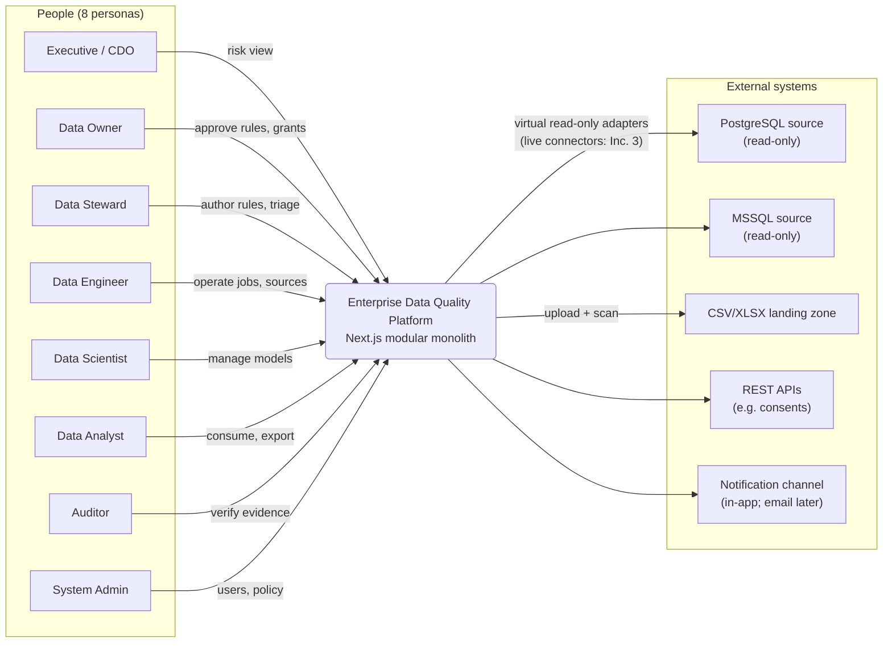
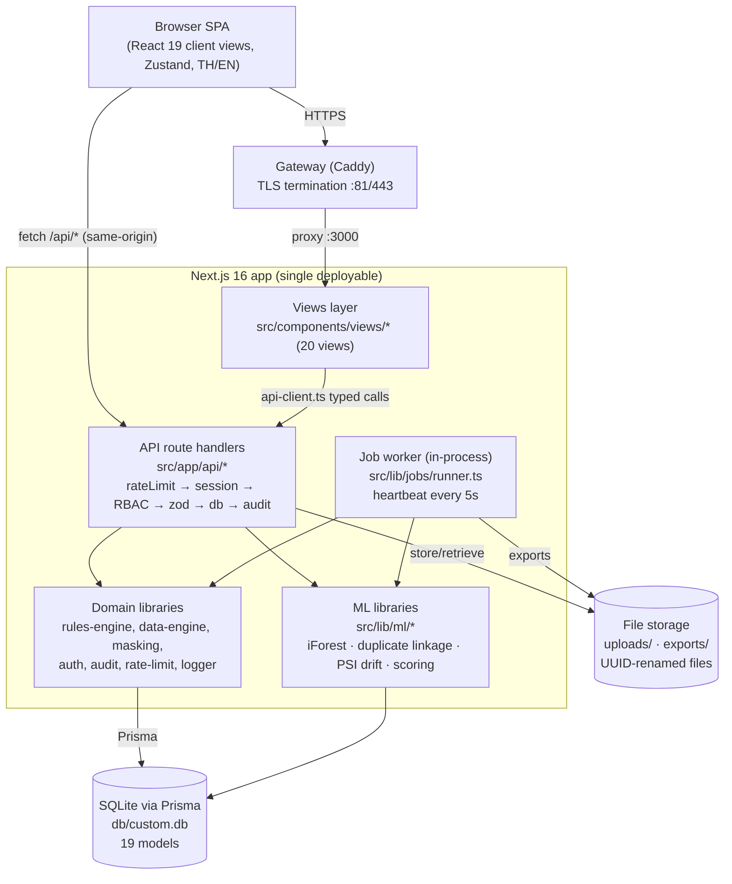
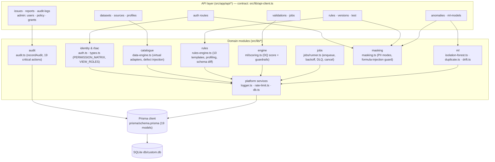
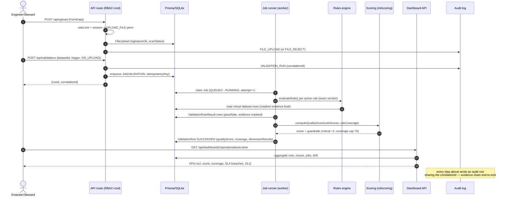
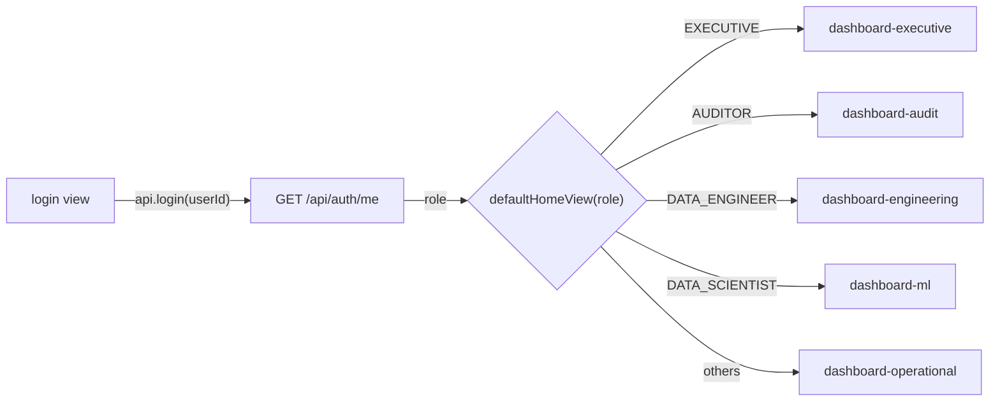
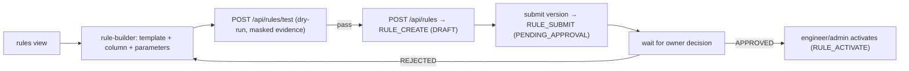
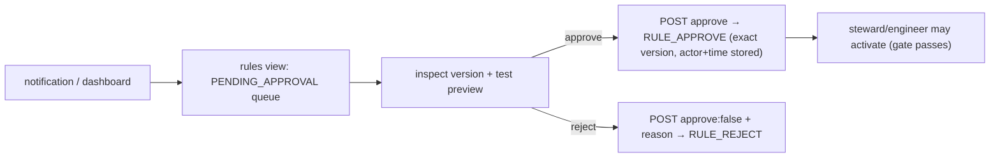
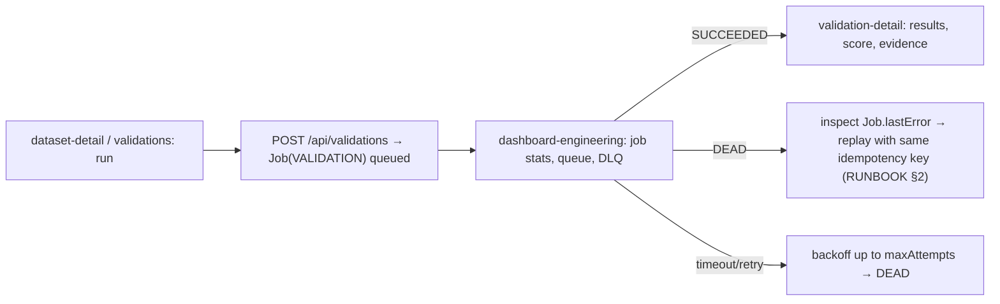

# Architecture — Enterprise Data Quality Platform (EDQP)

Next.js 16 modular monolith (App Router, TypeScript, Tailwind 4/shadcn), Prisma + SQLite, in-process job worker. Sandbox stack adaptation of FastAPI/PostgreSQL/Redis/Celery is an explicit, documented assumption — see `docs/GOVERNANCE.md` §2. Companion docs: `docs/GOVERNANCE.md` (framework), `docs/RUNBOOK.md` (operations), `docs/DEPLOYMENT.md` (deploy).

---

## 1. Requirement specification summary

**Goal:** a governed data-quality platform where business data products are catalogued, measured by versioned DQ rules and ML signals, scored transparently, and operated under segregation of duties with full audit evidence.

**Functional requirements**

- FR1 Catalogue of datasets/domains with owner, steward, classification, criticality, CDE flags, versions, SLA.
- FR2 No-code DQ rules (10 templates × 9 dimensions), versioned, approval-gated, activation-controlled.
- FR3 Validation engine with profiling, schema-drift diff, per-rule masked evidence.
- FR4 Transparent DQ score with anti-gaming guardrails (critical damping, CDE-coverage cap).
- FR5 ML anomaly detection (outliers, duplicates, drift) as human-reviewed signals with model attribution.
- FR6 Issue workflow with severity SLAs and acceptance path.
- FR7 Five role dashboards (executive, operational, engineering, ML, audit).
- FR8 Reports/exports with classification + masking notice, audited.
- FR9 Immutable audit trail with correlation IDs; policy parameters configurable at runtime.
- FR10 Secure file upload (signature check, quarantine) and notifications.

**Non-functional requirements**

- NFR1 RBAC: 8 roles, 23 permissions, deny-by-default; dataset-level grants (404-not-403).
- NFR2 PII masking (FULL/PARTIAL) in payloads, evidence, exports, logs.
- NFR3 Bilingual TH/EN across UI and findings.
- NFR4 Job guarantees: idempotency keys, retry + exponential backoff, timeout, DLQ, cancellation.
- NFR5 Rate limiting (sliding window, 120 req/min default); structured JSON logs without PII.
- NFR6 Accessibility: ≥40px touch targets, text summaries beside charts, clear loading/empty/error/denied states.

## 2. Context diagram (C4-context style)



## 3. Container diagram



Scaling note: the worker polls the `Job` table, so it can be split into a separate process without protocol changes (`docs/DEPLOYMENT.md` §5).

## 4. Component diagram



Route guard chain (every mutation): `rateLimit → getSessionUser → hasPermission → zod validation → db → recordAudit → JSON`. Dataset-scoped reads additionally check `DatasetPermission` and answer **404** (never 403) when denied.

## 5. Logical data model (ER)

19 models — source of truth `prisma/schema.prisma` (worklog's "18 models" headline predates `FileUpload`).

```mermaid
erDiagram
    USER ||--o{ DATASET_PERMISSION : receives
    DATASET ||--o{ DATASET_PERMISSION : "granted on"
    DATA_SOURCE ||--o{ DATASET : feeds
    DATASET ||--o{ DATASET_COLUMN : describes
    DATASET ||--o{ PROFILE_SNAPSHOT : profiles
    DATASET ||--o{ RULE : "governed by"
    RULE ||--o{ RULE_VERSION : "has"
    DATASET ||--o{ VALIDATION_RUN : runs
    VALIDATION_RUN ||--o{ VALIDATION_RULE_RESULT : produces
    RULE ||--o{ VALIDATION_RULE_RESULT : "evaluated as"
    DATASET ||--o{ ANOMALY : "flags"
    MLMODEL ||--o{ ANOMALY : detected_by
    MLMODEL ||--o{ MLMODEL : shadows
    DATASET ||--o{ ISSUE : tracks
    ISSUE ||--o{ ISSUE_COMMENT : discusses

    USER {
        string id PK
        string email UK
        string role "8 roles"
        string businessUnit
        boolean mfaEnabled
        boolean active
    }
    DATASET_PERMISSION {
        string id PK
        string userId FK
        string datasetId FK
        string level "VIEW | MANAGE"
        string reason
    }
    DATA_SOURCE {
        string id PK
        string type "CSV|XLSX|POSTGRESQL|MSSQL|REST_API"
        string health "HEALTHY|DEGRADED|DOWN|UNKNOWN"
        string connectionRef "secret manager ref only"
    }
    DATASET {
        string id PK
        string domain "6 domains"
        string classification "4 tiers"
        string criticality
        boolean isCde
        string version
        int slaHours
        string ownerId FK
        string stewardId FK
    }
    DATASET_COLUMN {
        string id PK
        string datasetId FK
        string dataType
        boolean isPii
        string piiType "NAME|EMAIL|PHONE|ID_CARD|ACCOUNT"
        boolean isCde
    }
    PROFILE_SNAPSHOT {
        string id PK
        string datasetId FK
        string datasetVersion
        float duplicateRate
        json columns
        json schema
    }
    RULE {
        string id PK
        string code UK "R-001"
        string datasetId FK
        string dimension "9 dimensions"
        string severity
        boolean isActive
        int currentVersion
        string templateKey "10 templates"
    }
    RULE_VERSION {
        string id PK
        string ruleId FK
        int version "unique with ruleId"
        json definition
        string status "DRAFT|PENDING_APPROVAL|APPROVED|REJECTED|RETIRED"
        string approvedBy
        string rejectedReason
    }
    VALIDATION_RUN {
        string id PK
        string datasetId FK
        string datasetVersion
        string ruleSetVersion
        string status "QUEUED|RUNNING|SUCCEEDED|FAILED|CANCELLED|PARTIAL"
        float qualityScore
        float coverage
        string correlationId UK
        int attempt
    }
    VALIDATION_RULE_RESULT {
        string id PK
        string runId FK
        string ruleId FK
        int ruleVersion
        string status "PASSED|FAILED|WARNING|ERROR|SKIPPED"
        float passRate
        json evidence "masked samples"
    }
    ANOMALY {
        string id PK
        string datasetId FK
        string type "NUMERIC_OUTLIER|DUPLICATE|SCHEMA_DRIFT|DATA_DRIFT|VOLUME_SHIFT"
        float score
        string rawStat "e.g. PSI=0.28"
        string modelId FK
        json contributingFeatures
        string reviewStatus "PENDING|CONFIRMED_ISSUE|FALSE_POSITIVE"
    }
    MLMODEL {
        string id PK
        string algorithm "IF|LOF|DuplicateLinkage|DriftMonitor"
        string stage "REGISTERED|VALIDATED|SHADOW|PROMOTED|RETIRED"
        json metrics
        string shadowOfId FK
        boolean isActive
    }
    ISSUE {
        string id PK
        string key UK "DQ-1001"
        string datasetId FK
        string severity
        string status "OPEN|IN_PROGRESS|PENDING_REVIEW|RESOLVED|CLOSED|REJECTED"
        string sourceType "RULE|ML|MANUAL|SCHEMA_DRIFT"
        boolean slaBreached
    }
    ISSUE_COMMENT {
        string id PK
        string issueId FK
        string author
    }
    JOB {
        string id PK
        string type "PROFILING|VALIDATION|ANOMALY_SCAN|EXPORT|RETENTION"
        string status "QUEUED|RUNNING|SUCCEEDED|FAILED|DEAD|CANCELLED"
        string idempotencyKey UK
        int attempts
        string lastError
    }
    AUDIT_LOG {
        string id PK
        string actor
        string action "19 critical actions"
        string resourceId
        json detail
        string correlationId
    }
    NOTIFICATION {
        string id PK
        string userId FK
        string titleEn
        string titleTh
        string severity
    }
    POLICY_SETTING {
        string key PK
        json value
        string updatedBy
    }
    FILE_UPLOAD {
        string id PK
        string storedName "UUID, outside web root"
        boolean signatureOk
        string scanStatus "PENDING|CLEAN|INFECTED|SKIPPED"
        string status "ACCEPTED|REJECTED|QUARANTINED"
        string uploadedBy FK
    }
```



## 6. Data flow (upload → validate → job → results → score → dashboard → audit)



## 7. Threat model (STRIDE)

≥12 rows; every mitigation listed is implemented in this MVP (references are code paths).

| # | Threat (STRIDE) | Scenario | Mitigation implemented | Evidence |
|---|---|---|---|---|
| T1 | **Spoofing** — forged session | Attacker crafts a session cookie | HMAC-SHA256 signed cookie (`edqp_session`), `timingSafeEqual` verify, httpOnly, SameSite=Lax, `secure` in prod, 8 h maxAge | `src/lib/auth.ts` |
| T2 | Spoofing — user impersonation at login | Shared demo identities | Per-user identity + login/logout audited; MFA flag on privileged users; OIDC swap-point (Inc. 2) | audit LOGIN/LOGOUT |
| T3 | **Tampering** — rule logic changed after approval | Steward edits an approved rule | Approved `RuleVersion` immutable; changes create a new version requiring re-approval; results pin `ruleVersion` | `prisma/schema.prisma` (@@unique ruleId+version) |
| T4 | Tampering — request payload manipulation | Client skips approval by calling API directly | Server-side permission + status re-checks in every route (activation requires APPROVED latest version) | route guard chain (§4) |
| T5 | **Repudiation** — admin denies granting access | Dispute over a GRANT_CHANGE | Append-only `AuditLog` with actor, role, IP, UA, correlationId; no update/delete API | `src/lib/audit.ts` |
| T6 | Repudiation — denied export | "I never exported that" | `EXPORT` audit with classification + masking level + auditId returned to caller | `POST /api/reports/export` |
| T7 | **Information disclosure** — ungranted dataset probed | Attacker enumerates dataset IDs | Deny-by-default grants; 404 `Resource not found or not permitted` (never 403) — no existence disclosure | API contract |
| T8 | Information disclosure — PII in UI/evidence/logs | Analyst views failure samples | `maskByPiiType` FULL default (`NONE` rejected for PII); evidence masked **before persistence**; logger forbids raw PII | `src/lib/masking.ts`, `src/lib/logger.ts` |
| T9 | Information disclosure — over-broad export | Bulk download of RESTRICTED data | Export requires permission, states classification + masking level, explicit confirm, audited | §22 R6 |
| T10 | **Denial of service** — request flood | Scripted hammering | Sliding-window rate limit per IP+route (120/min default, Redis swap-point) | `src/lib/rate-limit.ts` |
| T11 | DoS — runaway jobs | Huge dataset exhausts CPU | Per-job `timeoutMs` with AbortController; bounded 25-job batch per poll; retries capped by `maxAttempts` → DLQ | `src/lib/jobs/runner.ts` |
| T12 | DoS — malicious upload | Zip-bomb / spoofed file | Size cap (`upload.maxSizeMB`), extension allowlist, magic-byte signature check, quarantine + reject path | `FileUpload` lifecycle |
| T13 | **Elevation of privilege** — steward approves own rule | SoD bypass attempt | `APPROVE_RULE` absent from steward role; approval binds actor on the exact version; submitter≠approver checkable in audit | `PERMISSION_MATRIX`, `RuleVersion.approvedBy` |
| T14 | Elevation — user self-promotes role | PATCH on own profile | Role changes only via `POST /api/admin/users/:id/role` (`ADMIN_USERS`), audited `USER_ROLE_CHANGE` | API contract |
| T15 | Elevation — policy tampering | Engineer lowers masking to NONE | `ADMIN_POLICY` restricted to SYSTEM_ADMIN; `NONE` rejected for PII; `POLICY_UPDATE` audited with value | `POLICY_DEFAULTS`, `masking.ts` |

## 8. API specification

Contract source of truth: `src/lib/api-client.ts` (route handlers are implemented to match it under `src/app/api/**`). Permissions refer to `PERMISSION_MATRIX` (`src/lib/types.ts`); audit actions per `CRITICAL_AUDIT_ACTIONS`.

| # | Method | Path | Permission | Audit action |
|---|---|---|---|---|
| 1 | GET | `/api/auth/me` | any (session) | — |
| 2 | POST | `/api/auth/login` | public (demo user select) | LOGIN |
| 3 | POST | `/api/auth/logout` | any (session) | LOGOUT |
| 4 | GET | `/api/admin/users` | ADMIN_USERS | — |
| 5 | GET | `/api/datasets` | VIEW_DATASET | — (grant-filtered) |
| 6 | GET | `/api/datasets/:id` | VIEW_DATASET | — (404 if ungranted) |
| 7 | GET | `/api/datasets/:id/tabs` | VIEW_DATASET | DATA_PREVIEW (preview tab) |
| 8 | GET | `/api/datasets/:id/profiles` | VIEW_PROFILE | — |
| 9 | POST | `/api/datasets/:id/profiles` | RUN_VALIDATION | VALIDATION_RUN (profiling job) |
| 10 | GET | `/api/sources` | VIEW_DATASET | — |
| 11 | POST | `/api/sources` | MANAGE_SOURCE | — |
| 12 | GET | `/api/rules` | VIEW_RULE | — |
| 13 | POST | `/api/rules` | CREATE_RULE | RULE_CREATE |
| 14 | GET | `/api/rules/:id` | VIEW_RULE | — |
| 15 | POST | `/api/rules/:id/versions` | CREATE_RULE | RULE_CREATE (new version) |
| 16 | POST | `/api/rules/:id/versions/:v/submit` | SUBMIT_RULE | RULE_SUBMIT |
| 17 | POST | `/api/rules/:id/versions/:v/approve` | APPROVE_RULE | RULE_APPROVE / RULE_REJECT |
| 18 | POST | `/api/rules/:id/activate` | ACTIVATE_RULE | RULE_ACTIVATE |
| 19 | POST | `/api/rules/:id/deactivate` | ACTIVATE_RULE | RULE_ACTIVATE |
| 20 | POST | `/api/rules/test` | VIEW_RULE (steward/owner UI) | — (dry-run, no persistence) |
| 21 | GET | `/api/validations` | VIEW_VALIDATION | — |
| 22 | GET | `/api/validations/:id` | VIEW_VALIDATION | — |
| 23 | POST | `/api/validations` | RUN_VALIDATION | VALIDATION_RUN |
| 24 | GET | `/api/anomalies` | VIEW_ANOMALY | — |
| 25 | POST | `/api/anomalies/:id/review` | REVIEW_ANOMALY | ANOMALY_REVIEW |
| 26 | POST | `/api/anomalies/scan` | RUN_VALIDATION | VALIDATION_RUN (ANOMALY_SCAN job) |
| 27 | GET | `/api/issues` | VIEW_ISSUE | — |
| 28 | POST | `/api/issues` | MANAGE_ISSUE | ISSUE_UPDATE |
| 29 | PATCH | `/api/issues/:id` | MANAGE_ISSUE | ISSUE_UPDATE |
| 30 | GET | `/api/ml-models` | VIEW_ML | — |
| 31 | POST | `/api/ml-models` | MANAGE_ML | — (registration; transitions below) |
| 32 | POST | `/api/ml-models/:id/stage` | MANAGE_ML | MODEL_PROMOTE / MODEL_SHADOW |
| 33–37 | GET | `/api/dashboards/executive` · `/operational` · `/engineering` · `/ml` · `/audit` | VIEW_DASHBOARD (dashboard views additionally gated by VIEW_ROLES) | — |
| 38 | POST | `/api/reports/export` | EXPORT_REPORT | EXPORT |
| 39 | GET | `/api/audit-logs` | VIEW_AUDIT | — |
| 40 | GET | `/api/admin/policy` | ADMIN_POLICY | — |
| 41 | POST | `/api/admin/policy` | ADMIN_POLICY | POLICY_UPDATE |
| 42 | POST | `/api/admin/users/:id/role` | ADMIN_USERS | USER_ROLE_CHANGE |
| 43 | POST | `/api/admin/grants` | MANAGE_DATASET | GRANT_CHANGE |
| 44 | GET | `/api/jobs` | VIEW_DASHBOARD | — |
| 45 | POST | `/api/jobs/:id/cancel` | RUN_VALIDATION | — (cancel is recorded on the Job row) |
| 46 | GET | `/api/search` | any (session) | — |
| 47 | GET | `/api/notifications` | any (session) | — |
| 48 | POST | `/api/notifications/:id/read` | any (session, own) | — |
| 49 | POST | `/api/upload` | UPLOAD_FILE | FILE_UPLOAD / FILE_REJECT |
| 50 | GET | `/api/health` | public | — |

Error contract: `ApiError { status, message, auditId? }`; dataset-scoped denials return **404** with `{ error: "Resource not found or not permitted" }`.

## 9. UI sitemap (20 views + role gating)

Gating from `VIEW_ROLES` (`src/lib/types.ts`); navigation is permission-filtered; unauthorised views render the `Denied` state.

| View key | Screen | Roles allowed |
|---|---|---|
| `login` | Identity selection (demo auth) | * |
| `dashboard-executive` | Enterprise risk & score | EXECUTIVE, SYSTEM_ADMIN, DATA_OWNER, AUDITOR |
| `dashboard-operational` | DQ operations & SLAs | STEWARD, OWNER, ENGINEER, ANALYST, SCIENTIST, EXEC, ADMIN |
| `dashboard-engineering` | Jobs, sources, run stats | DATA_ENGINEER, SYSTEM_ADMIN |
| `dashboard-ml` | Models, anomalies, shadow comparisons | SCIENTIST, ADMIN, ENGINEER, EXEC, AUDITOR |
| `dashboard-audit` | Critical events, evidence completeness | AUDITOR, SYSTEM_ADMIN, EXECUTIVE |
| `data-sources` | Source registry & health | SYSTEM_ADMIN, DATA_ENGINEER |
| `catalogue` | Data products & domains | all 8 roles |
| `dataset-detail` | Dataset governance record (tabs) | all 8 roles (grant-checked) |
| `profiling` | Profile history & drill-down | ADMIN, OWNER, STEWARD, ENGINEER, ANALYST, SCIENTIST |
| `rules` | Rule inventory & lifecycle states | ADMIN, OWNER, STEWARD, ENGINEER, ANALYST |
| `rule-builder` | No-code authoring + test | SYSTEM_ADMIN, DATA_STEWARD, DATA_OWNER |
| `validations` | Run history & triggers | ADMIN, OWNER, STEWARD, ENGINEER, ANALYST |
| `validation-detail` | Run results & masked evidence | ADMIN, OWNER, STEWARD, ENGINEER, ANALYST, AUDITOR |
| `anomalies` | ML findings triage | ADMIN, OWNER, STEWARD, ENGINEER, ANALYST, SCIENTIST, AUDITOR |
| `issues` | Issue workflow & SLA | all 8 roles |
| `ml-models` | Model registry & lifecycle | ADMIN, SCIENTIST, ENGINEER, EXEC, AUDITOR |
| `reports` | Export centre | all 8 roles |
| `audit-logs` | Evidence search | AUDITOR, SYSTEM_ADMIN |
| `administration` | Users, roles, policy | SYSTEM_ADMIN |

Default home by role (`defaultHomeView`): EXECUTIVE→executive dashboard, AUDITOR→audit dashboard, ENGINEER→engineering dashboard, SCIENTIST→ML dashboard, others→operational dashboard.

## 10. Screen flows

**Login → home by role**



**Steward rule flow (author → submit)**



**Owner approval flow**



**Engineer job flow (run → monitor → triage)**



## 11. Wireframe descriptions (key screens)

- **login** — centered bilingual card listing seeded demo identities grouped by persona; one-click sign-in, no password field (demo auth), footer notes OIDC roadmap.
- **dashboard-executive** — headline ScoreRing with 30-day TrendLine; KPI cards (coverage, open issues, SLA breaches); datasets-at-risk table with 7-day deltas; business-unit risk bars; SLA breach list linking to issues.
- **dashboard-operational** — "needs attention" table (score + failed rules + last run), late datasets vs SLA, schema drift feed, jobs-attention strip, KPI row (active rules, runs 24h, pass rate, avg duration, queue depth, DLQ).
- **dashboard-engineering** — source health cards (latency p95, success rate), job status counters (queued/running/succeeded/failed/dead), recent jobs table with cancel action, 14-day run/fail TrendLine.
- **dashboard-ml** — model registry table with stage badges and metrics, anomaly stats by type, detection trend, champion-vs-challenger shadow comparison deltas, persistent `<MlDisclaimer />`.
- **dashboard-audit** — critical events feed, event-count bars per action, actor stats, export/reject counters, evidence-completeness gauge (correlation-ID coverage).
- **data-sources** — registry table (type, health badge, host, connectionRef shown as secret reference only), last sync, add-source drawer (engineer/admin).
- **catalogue** — filterable grid of data products (domain chips, classification badge, CDE star, score, owner/steward, version); search box hits `/api/search`.
- **dataset-detail** — header with classification/criticality/CDE/version/SLA and owner-steward pair; tab strip (overview, columns+PII map, profile history, rules, runs, anomalies, issues, preview); every tab a permissioned API call.
- **profiling** — snapshot list with row counts, null-rate avg, duplicate rate; drill-down column histograms and top values (masked where PII); "run profiling" action → job toast.
- **rules** — inventory with lifecycle StatusBadge (DRAFT/PENDING_APPROVAL/APPROVED/RETIRED), dimension/severity filters, version stepper in drawer; Activate button appears only when latest version is APPROVED.
- **rule-builder** — template picker → column select → operator parameters form, live natural-language summary (EN/TH), test panel showing pass rate and masked failure rows before submit.
- **validations** — run history (trigger, status, duration, score, coverage, correlationId) with rerun action; filter by dataset/status.
- **validation-detail** — per-rule results table (status, pass rate, failed rows, evidence drawer with masked samples + bilingual reasons), dimension breakdown bars, guardrail banner when coverage cap engaged.
- **anomalies** — triage queue by type/severity; detail panel shows model name+version, raw stat, contributing features bar, detection time, dataset version, masked row values; review actions (confirm/false-positive) with note.
- **issues** — kanban-ish list by status with SLA countdown badges (breached in red), severity filter, detail drawer with comments, assignee, resolution note and acceptance path.
- **ml-models** — registry table (algorithm, version, stage, metrics, active flag), stage-transition actions gated to SCIENTIST/ADMIN, shadow lineage (shadowOf) shown inline.
- **reports** — export centre: report type, dataset scope, format; classification + masking notice and explicit confirm dialog before POST; result shows download link + auditId.
- **audit-logs** — forensics table (actor, action, resource, IP, correlationId, time) with action/actor filters and full-text search; auditor-only, read-only.
- **administration** — user table with role editor, dataset grant manager (level + reason), policy editor listing §30 parameter keys with JSON values and updatedBy/updatedAt; every mutation audited.

## 12. Repository structure

```
/home/z/my-project
├── docs/                        # this documentation set
│   ├── GOVERNANCE.md
│   ├── ARCHITECTURE.md
│   ├── RUNBOOK.md
│   └── DEPLOYMENT.md
├── deploy/
│   ├── Dockerfile               # multi-stage (deps → build → runner)
│   ├── docker-compose.yml       # app + volumes; postgres/redis as swap targets
│   └── ci.yml                   # GitHub Actions (bun, tsc, lint, build)
├── prisma/
│   ├── schema.prisma            # 19 models — ER source of truth
│   └── seed.ts                  # idempotent seed (FORCE_SEED=1 to reset)
├── db/
│   └── custom.db                # SQLite database (DATABASE_URL target)
├── src/
│   ├── app/
│   │   ├── api/                 # route handlers (contract: src/lib/api-client.ts)
│   │   ├── layout.tsx
│   │   ├── page.tsx
│   │   └── globals.css
│   ├── components/
│   │   ├── shared/
│   │   │   ├── kit.tsx          # PageShell, StatusBadge, DataTable, states, ScoreRing…
│   │   │   └── charts.tsx       # accessible SVG TrendLine/HBar/StackedBars/Histogram
│   │   ├── views/
│   │   │   └── ctx.ts           # ViewCtx { user, navigate, params } (views: 2-b..2-e)
│   │   └── ui/                  # shadcn/radix primitives
│   ├── hooks/                   # use-toast, use-mobile
│   └── lib/
│       ├── types.ts             # DTOs, Role/Permission matrix, VIEW_ROLES, POLICY_DEFAULTS
│       ├── api-client.ts        # typed API contract (single source of API truth)
│       ├── auth.ts              # HMAC session cookie (OIDC-ready)
│       ├── audit.ts             # recordAudit + CRITICAL_AUDIT_ACTIONS
│       ├── masking.ts           # PII masking + formula-injection sanitiser
│       ├── logger.ts            # structured JSON logs + correlation ids
│       ├── rate-limit.ts        # sliding-window limiter (Redis swap-point)
│       ├── db.ts                # Prisma client singleton
│       ├── data-engine.ts       # virtual read-only source adapters + defect injection
│       ├── rules-engine.ts      # 10-template evaluation, profiling, schema drift diff
│       ├── jobs/runner.ts       # in-process worker (idempotency, backoff, DLQ)
│       ├── ml/
│       │   ├── isolation-forest.ts
│       │   ├── duplicate.ts
│       │   ├── drift.ts
│       │   └── scoring.ts       # DQ score + anti-gaming guardrails
│       ├── i18n.tsx             # TH/EN <T> + formatters
│       ├── store.ts             # Zustand UI store
│       └── utils.ts
├── public/                      # static assets
├── uploads/                     # uploaded files (UUID-renamed) — volume in compose
├── exports/                     # generated exports (created on first export) — volume in compose
├── Caddyfile                    # dev gateway / TLS termination point
├── package.json                 # scripts: dev, build, start, lint, db:push, db:generate…
└── worklog.md                   # shared multi-agent worklog
```

> Note: view components (`src/components/views/*.tsx`) and API route handlers (`src/app/api/**/route.ts`) are being built by parallel agents (2-a..2-e) to the contracts above; `src/instrumentation.ts` starts the worker heartbeat on boot (nodejs runtime), per the worklog contract.
