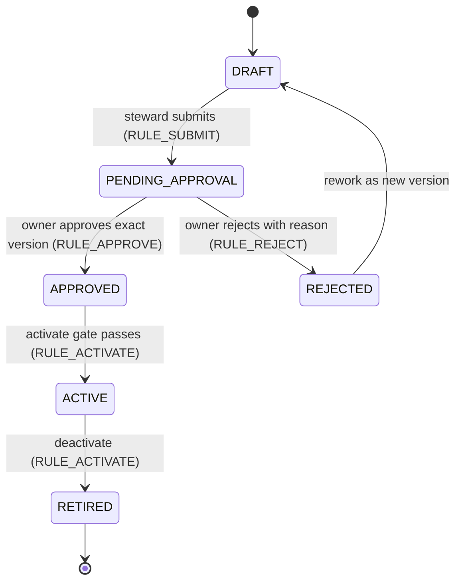
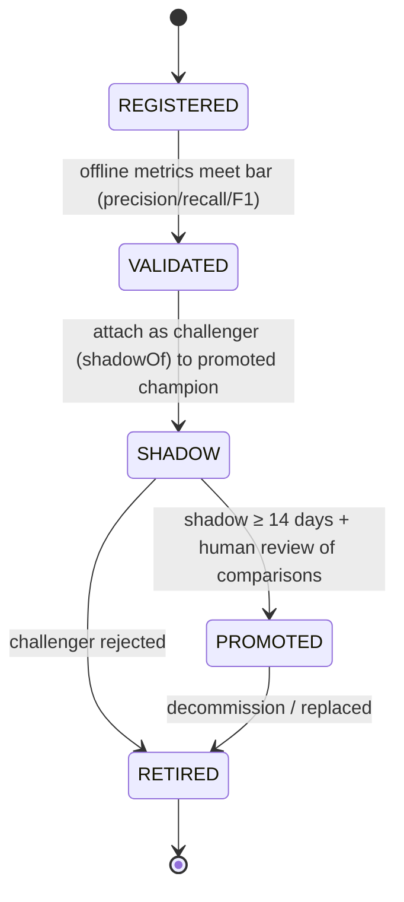

# Enterprise Data Governance & Data Quality Framework

**Platform:** Enterprise Data Quality Platform (EDQP) — Next.js 16 modular monolith
**Status:** Increment 1 (MVP) delivered — see `worklog.md` and `docs/ARCHITECTURE.md`
**Legal note:** regulatory references (PDPA, BCBS 239) are marked **subject to Legal/DPO validation**; this document claims compliance with nothing — it maps controls to obligations for review.

---

## 1. Executive summary

EDQP is a governed data-quality workbench that gives a bank/enterprise a single place to **catalogue critical datasets, author versioned data-quality (DQ) rules, run validations and ML anomaly scans, score quality with an anti-gaming formula, triage issues against SLAs, and produce audit evidence**.

Delivered in Increment 1:

- **6 governed domains / 6 seeded data products** (Customer, Finance, Product, Sales, Marketing, Service) over 4 source types.
- **9 DQ dimensions** (ISO/IEC 25012-aligned) and **10 no-code rule templates**; 22 seeded rules with real version states.
- **A transparent DQ score** (`src/lib/ml/scoring.ts`): weighted mean of per-dimension pass rates, renormalised over measured dimensions, with two anti-gaming guardrails (CRITICAL-fail damping, CDE-coverage cap at 70).
- **Segregation of duties**: steward authors → owner approves (exact version) → engineer operates → auditor verifies, all on an immutable `AuditLog` with correlation IDs.
- **ML as signals, not verdicts**: Isolation Forest outliers, Jaro-Winkler duplicate linkage, PSI drift — every finding requires named-model attribution, contributing features, and human review (`<MlDisclaimer />`); no auto-remediation exists anywhere in the codebase.
- **Deny-by-default access**: dataset-level grants, PII masking (FULL/PARTIAL, `NONE` rejected for PII), 404-not-403 responses, TH/EN bilingual UI.

Baseline seeded pipeline results (real engine runs): Customer Master 84.5 (2 failed rules), GL 99.4, Product 99, Orders 100, Marketing Consents 70 (CDE-coverage cap engaged), Tickets 93.6.

## 2. Explicit assumptions (sandbox stack adaptation)

The original requirement specified FastAPI + PostgreSQL + Redis + Celery + scikit-learn/MLflow + OIDC. This MVP is a sandbox-stack adaptation; every deviation is a **documented swap-point** with a contract-preserving replacement path:

| # | Requirement assumed | Implemented as | Swap-point | Production target |
|---|---|---|---|---|
| A1 | FastAPI service layer | Next.js 16 Route Handlers (modular monolith), contract frozen in `src/lib/api-client.ts` | Replace route handlers; DTOs in `src/lib/types.ts` unchanged | FastAPI or keep Next.js |
| A2 | PostgreSQL | SQLite via Prisma (`db/custom.db`, string-based state fields; TS unions enforce values at the edge) | Change `provider` in `prisma/schema.prisma` + `DATABASE_URL` | PostgreSQL |
| A3 | Celery + Redis broker | In-process job runner polling the `Job` table (`src/lib/jobs/runner.ts`); idempotency keys, retry/backoff, DLQ are already Celery-equivalent semantics | Swap runner for Celery worker; `Job` row = task message | Celery + Redis |
| A4 | scikit-learn + MLflow | TypeScript ML: Isolation Forest, Jaro-Winkler linkage, PSI drift (`src/lib/ml/*`); model registry is the `MLModel` table | Replace algorithms behind same DTOs; registry stage transitions unchanged | MLflow model registry |
| A5 | OIDC SSO | Demo auth: HMAC-signed httpOnly session cookie (`src/lib/auth.ts`), user-per-role seeded identities | Swap login handler for OIDC code flow; `getSessionUser()` contract identical | Keycloak/Entra ID (OIDC) |
| A6 | Live connectors | Virtual read-only source adapters with deterministic defect injection (`src/lib/data-engine.ts`) | Implement adapters behind `getDatasetData()` | Read-only DB/REST connectors |
| A7 | ClamAV AV scanning | `FileUpload.scanStatus` lifecycle (PENDING/CLEAN/INFECTED/SKIPPED) with magic-byte signature check | Wire scanner into upload handler | ClamAV daemon |
| A8 | Object storage for uploads/exports | Local `uploads/` + `exports/` directories (UUID-renamed stored files) | Storage adapter swap | S3 |
| A9 | Redis-backed rate limiting | In-memory sliding window (`src/lib/rate-limit.ts`) | Keep `rateLimit(key, limit)` signature | Redis |

**Legal claims are NOT invented.** Where this document mentions PDPA (consent ledger dataset) or BCBS 239 (GL as risk-reporting critical data), the text is a *mapping candidate* and is marked **subject to Legal/DPO validation**.

## 3. Governance principles (12 mandatory)

These twelve principles are binding on every increment; controls in §22 trace to them.

1. **Accountability** — every dataset has exactly one named Data Owner; accountability is never shared or anonymous.
2. **Stewardship** — every governed dataset has a named Steward who executes day-to-day quality operations.
3. **Segregation of duties** — the author of a control is never its approver, operator, or verifier.
4. **Deny by default** — access to a dataset requires an explicit grant; absence of permission is indistinguishable from absence of the resource (404, never 403).
5. **Data minimisation & masking by default** — PII is masked in every payload, log, evidence row and export; unmasked PII requires a justification trail.
6. **Evidence-based decisions** — every critical action produces an immutable, correlation-ID-bearing audit record; decisions without evidence are invalid.
7. **Versioned, approved change** — rules, policies and model stages change only through versioned, approved transitions; approved versions are immutable.
8. **Critical data first** — CDEs get coverage floors, severity weighting and the strongest controls; effort is proportional to materiality.
9. **Transparent measurement** — the DQ score formula, weights and guardrails are published policy, not hidden logic; gaming is designed out, not policed after the fact.
10. **Human review of machine signals** — ML detections are signals requiring named-model attribution and human confirmation; the platform never auto-remediates data.
11. **Fit-for-purpose quality** — dimensions and thresholds serve the stated business use; chasing perfect scores on immaterial data is itself a governance failure.
12. **Least privilege & audited administration** — administrative powers (roles, grants, policy) are minimal, personal, and audited; shared admin accounts are prohibited.

## 4. Target operating model

Hub-and-spoke: a small **Platform team** (hub) operates the EDQP product; **federated domain roles** (spokes) own and steward their data products.

- **Hub (Platform team):** platform availability, RBAC administration, policy configuration, job infrastructure, ML tooling, audit tooling. Does not decide data content.
- **Spoke (domains):** Data Owners decide classification, access grants, rule approval and issue acceptance for their domain; Stewards author rules, triage anomalies/issues; Engineers operate pipelines.
- **Cadence:** weekly operational DQ review (stewards + engineers, driven by `dashboard-operational`); monthly Data Governance Council (driven by `dashboard-executive`); quarterly control self-assessment (driven by `dashboard-audit`).
- **Escalation path:** engineer/steward → owner → Data Governance Council. SLA breaches (§19) auto-escalate via `slaBreached` flagging and notifications.

## 5. Governance bodies & decision rights

| Body / role | Composition | Decides | Consulted / informed |
|---|---|---|---|
| **Data Governance Council** | CDO (chair, EXECUTIVE), Data Owners, Head of Platform, Internal Audit (observer), Legal/DPO (invited) | Policy parameter changes with material effect, CDE designation, classification of new domains, exception/acceptance of critical risks, maturity targets | Monthly minutes; DQ KPI pack from Executive dashboard |
| **Data Owner** (per domain) | Business data owner (e.g. Head of Customer Data) | Dataset classification & criticality, rule version approval, dataset grants, anomaly confirmation, issue closure/acceptance | Steward proposals; auditor findings |
| **Data Steward** (per domain) | Domain steward | Rule authoring & submission, profiling cadence, issue investigation root-cause | Engineers for pipeline feasibility |
| **Platform team** | Admin + engineers | Platform policy parameter values within Council-approved ranges, job/runtime operations, user role changes (on HR/ticket authority), source registration | Owners/stewards on dataset changes; auditors on logs |

Decision rights are enforced technically: `APPROVE_RULE` belongs only to DATA_OWNER/SYSTEM_ADMIN; `ADMIN_POLICY` only to SYSTEM_ADMIN; grants only via `POST /api/admin/grants` (`MANAGE_DATASET`) and every one is audited (`GRANT_CHANGE`, `POLICY_UPDATE`, `USER_ROLE_CHANGE`).

## 6. Role definitions & RACI matrix

Eight personas (seeded one user each in `prisma/seed.ts`); permissions live in `PERMISSION_MATRIX` (`src/lib/types.ts`).

| Persona | Mission | Key powers |
|---|---|---|
| SYSTEM_ADMIN | Platform operation | All permissions (users, policy, grants) |
| DATA_OWNER | Accountable for a domain's data | Approve rules, manage datasets, confirm anomalies, close issues, run validations, upload |
| DATA_STEWARD | Executes quality work | Create/submit rules, run validations, review anomalies, manage issues, upload |
| DATA_ENGINEER | Operates pipelines/sources | Manage sources, run validations, upload; engineering dashboard |
| DATA_ANALYST | Consumes curated data | Read + profile + export |
| DATA_SCIENTIST | ML models & anomaly triage | Manage ML models, review anomalies |
| AUDITOR | Independent verification | Read-only everywhere incl. audit logs and validation detail |
| EXECUTIVE | Risk oversight | Executive dashboard, issues, ML view, export |

RACI (R=Responsible, A=Accountable, C=Consulted, I=Informed):

| Activity | Owner | Steward | Engineer | Scientist | Analyst | Auditor | Exec | SysAdmin |
|---|---|---|---|---|---|---|---|---|
| Dataset registration & classification | A | R | C | I | I | I | I | C |
| Access grants (dataset-level) | A/R | C | I | I | I | I | I | R |
| Rule authoring & submission | A | R | C | C | I | I | I | I |
| Rule approval (exact version) | **A/R** | I | I | I | I | I | I | C |
| Rule activation/deactivation | A | C | R | I | I | I | I | C |
| Validation & profiling runs | A | R | R | I | I | I | I | C |
| Anomaly review / triage | A | R | C | R | I | I | I | I |
| Issue management & closure | A | R | C | C | I | I | I | C |
| ML model lifecycle (stage changes) | I | I | C | **A/R** | I | I | I | C |
| Policy parameter changes | C | C | C | I | I | I | I | **A/R** |
| User role changes | I | I | I | I | I | C | C | **A/R** |
| Audit & evidence review | C | I | I | I | I | **A/R** | I | C |

## 7. Segregation of duties

Four-way separation, enforced by the permission matrix — no single role can complete a control change end-to-end (except SYSTEM_ADMIN, whose every action is audited and reviewed by the Council):

- **Steward authors** (`CREATE_RULE`, `SUBMIT_RULE`) — cannot approve (`APPROVE_RULE` absent).
- **Owner approves** (`APPROVE_RULE`) — approval binds to the **exact `RuleVersion`** (`@@unique([ruleId, version])`); the approver identity, timestamp and optional reason are stored on that version row (`approvedBy`, `approvedAt`, `rejectedReason`).
- **Engineer operates** (`RUN_VALIDATION`, `MANAGE_SOURCE`) — cannot author or approve rules.
- **Auditor verifies** (`VIEW_AUDIT`, read-only `READ` set) — holds no mutation permission at all.

**Immutability of approved versions:** once a version leaves DRAFT, its `definition` JSON is never edited; corrections produce a **new version** which re-enters the workflow. Activation gate (`ACTIVATE_RULE`) requires the rule's latest version status to be `APPROVED` — the UI hides Activate otherwise, and the API re-checks server-side. Self-approval by the submitting steward is a workflow violation detected in audit review (submitter ≠ approver comparison on `RuleVersion`).

## 8. Data domain & data product model

Six seeded domains, each a governed **data product** with an owner, steward, version, SLA and classification (`prisma/seed.ts`):

| Domain | Data product (seeded) | Source | Classification | Criticality | CDE | Seeded score |
|---|---|---|---|---|---|---|
| Customer | Customer Master 360 | PostgreSQL (read-only replica) | CONFIDENTIAL | CRITICAL | yes | 84.5 |
| Finance | General Ledger Transactions | MSSQL (read-only) | RESTRICTED | CRITICAL | yes | 99.4 |
| Product | Product Master | CSV landing zone | INTERNAL | HIGH | no | 99.0 |
| Sales | Sales Orders | PostgreSQL | INTERNAL | HIGH | no | 100.0 |
| Marketing | Marketing Consents (PDPA ledger)* | REST API | CONFIDENTIAL | HIGH | yes | 70.0 (coverage cap) |
| Service | Support Tickets | CSV drop from CRM | INTERNAL | MEDIUM | no | 93.6 |

\* PDPA relevance **subject to Legal/DPO validation**.

Domains are curated (not free-form): adding a domain is a Council decision because it implies an owner, steward and dashboard placement.

## 9. Dataset governance model

Governed attributes on `Dataset` (see `prisma/schema.prisma`):

- **Ownership:** `ownerId` (accountable), `stewardId` (operational) — both must reference active users.
- **Classification:** `PUBLIC | INTERNAL | CONFIDENTIAL | RESTRICTED` (§12) with per-column overrides on `DatasetColumn.classification`.
- **Criticality & CDE:** `CRITICAL | HIGH | MEDIUM | LOW` and `isCde` (§10); per-column `DatasetColumn.isCde`.
- **Version:** `version` (semver-like, e.g. `v3.2.0`); every profile, validation and anomaly references `datasetVersion`, so findings are always pinned to the exact data product version.
- **Effective dates:** `lastRefreshAt` for freshness; SLA `slaHours`; lifecycle `status: ACTIVE | DEPRECATED | ARCHIVED`.
- **Column metadata:** type, nullable, `isPii` + `piiType` (NAME | EMAIL | PHONE | ID_CARD | ACCOUNT), CDE flag, position — the basis for masking and coverage calculations.
- **PII inventory:** `piiFields` count is surfaced in catalogue views for minimisation reviews.

## 10. CDE methodology

**Identification criteria** (any one qualifies; Council ratifies):

1. Feeds regulatory or statutory reporting (e.g. GL into finance reporting — BCBS 239 candidate, **subject to Legal/DPO validation**).
2. Direct customer fairness/consent impact (identity, contact, PDPA consent — **subject to Legal/DPO validation**).
3. Financial materiality (limits, balances, prices).
4. Downstream model/decision dependency (features feeding credit or fraud decisions).

**Mechanics:** `Dataset.isCde` and `DatasetColumn.isCde` mark critical elements. During validation, the runner computes **CDE rule coverage** = fraction of CDE columns covered by at least one active rule (`src/lib/jobs/runner.ts`), stored as `ValidationRun.coverage`.

**Guardrails (policy `score.coverageFloor` = 0.6):** if CDE coverage < 0.6 the dataset score is **capped at 70** regardless of pass rates — an owner cannot look healthy while their critical elements are untested. The cap is reported in the score payload (`guardrails.capped`, bilingual note). Designated CDEs must also carry ≥1 CRITICAL-severity rule (roadmap check; see §27).

## 11. Metadata & business glossary

- **Business metadata:** `Dataset.name/nameTh/description`, `DatasetColumn.description` — bilingual (TH/EN) by convention.
- **Technical metadata:** `ProfileSnapshot` (row/column counts, null rates, distincts, quantiles, schema) per `datasetVersion`; `DatasetColumn` data types.
- **Governance metadata:** owner/steward, classification, criticality, CDE flags, SLA, version, effective dates.
- **Lineage metadata:** source linkage via `Dataset.sourceId → DataSource`; column-level lineage is Increment 4 (§27).
- **Glossary:** the catalogue view is the seed of the business glossary; glossary term ↔ column binding is a roadmap item. Today, column `description` is the authoritative business definition, and steward updates are audited as dataset metadata changes.

## 12. Classification & access framework

Four tiers (denominators for controls, not free text):

| Tier | Meaning | Handling |
|---|---|---|
| PUBLIC | No harm on disclosure | Shareable |
| INTERNAL | Internal-use business data | All staff with need |
| CONFIDENTIAL | Harm on disclosure (customer PII, consents) | Named grants; masked by default |
| RESTRICTED | Regulatory/high-harm (GL extracts) | Named grants; owner approval for any export |

Enforcement stack (all server-side):

1. **Authentication:** HMAC-signed httpOnly session cookie (`edqp_session`, 8 h, `secure` in production).
2. **Authorisation:** `PERMISSION_MATRIX` per action (`hasPermission`), plus **dataset-level grants** — `DatasetPermission (userId, datasetId, level: VIEW|MANAGE)` granted by an owner/admin with a recorded `reason`.
3. **Deny-by-default:** a dataset without a grant is invisible; API responds **404** (`Resource not found or not permitted`) — never 403 — so existence is not disclosed.
4. **PII masking:** `maskByPiiType` with policy `masking.defaultMode = FULL | PARTIAL` (`NONE` is not accepted for PII); applied to UI payloads, rule evidence (`valueMasked`), anomaly rows, and exports.
5. **Export control:** every export records classification, masking level and an audit ID; client must show the masking notice and confirm.

## 13. Data lifecycle model

```
create → ingest → profile → validate → certify → use → archive → purge
```

| Stage | Trigger | System behaviour | Evidence |
|---|---|---|---|
| Create | Council-approved dataset registration | `Dataset` + columns + owner/steward | audit `GRANT_CHANGE`/catalogue record |
| Ingest | Source sync or approved file upload | virtual adapter read / `POST /api/upload` with signature check, quarantine path | `FILE_UPLOAD` / `FILE_REJECT` |
| Profile | Schedule or steward action (`PROFILING` job) | `ProfileSnapshot` + schema-drift diff vs previous snapshot | job record + `SCHEMA_DRIFT` anomalies |
| Validate | Schedule, upload hook, API or manual (`VALIDATION` job) | rules evaluated → results, score, coverage | `ValidationRun` with `correlationId` |
| Certify | Owner reviews run + guardrails | score accepted for the version; failures become issues | issue trail, run marked in dashboards |
| Use | Analyst/owner consumption with grants | masked reads, audited previews/exports | `DATA_PREVIEW`, `EXPORT` |
| Archive | Product deprecation decision | `status=ARCHIVED`; runs/anomalies retained | catalogue status |
| Purge | Retention elapsed | `RETENTION` job type; uploads purged after `upload.retentionDays` (default **90**) | job record |

Retention is configurable (`upload.retentionDays`) and purge is a first-class job type — not a manual `rm`.

## 14. DQ dimensions (ISO/IEC 25012 mapping)

Nine implemented dimensions (`DIMENSIONS` in `src/lib/types.ts`). ISO/IEC 25012 defines 15 characteristics across inherent/system-dependent categories; EDQP implements the nine most material for this platform's use cases:

| Dimension | ISO 25012 characteristic | Definition (as measured here) |
|---|---|---|
| COMPLETENESS | Completeness (inherent) | Required values present (`NOT_NULL`) |
| ACCURACY | Accuracy (inherent) | Values correspond to reality (range/cross-field plausibility) |
| VALIDITY | Syntactic accuracy (inherent) | Values match format/domain (`REGEX`, `IN_SET`) |
| CONSISTENCY | Consistency (inherent) | Coherence across fields (`CROSS_FIELD`, `IN_SET` business domains) |
| UNIQUENESS | Uniqueness (inherent) | No unintended duplicates (`UNIQUE`, ML duplicate linkage) |
| TIMELINESS | Currentness (inherent/system) | Data fresh within bound (`FRESHNESS`, refresh SLA `slaHours`) |
| INTEGRITY | Consistency/Integrity (inherent) | Referential relations hold (`REFERENTIAL`) |
| VOLUME | Availability (system-dependent) | Row volume within expected band (`ROW_COUNT`) |
| SCHEMA_CONFORMITY | Syntactic conformity (system-dependent) | Structure matches expected schema (`SCHEMA_MATCH`, drift diff) |

Weights per dimension are policy (`score.weights`), defaults: COMPLETENESS 0.20, VALIDITY 0.15, UNIQUENESS 0.15, ACCURACY/CONSISTENCY/TIMELINESS/SCHEMA_CONFORMITY 0.10, INTEGRITY 0.05, VOLUME 0.05.

## 15. Rule taxonomy

Ten no-code templates (`RuleTemplate`); matrix shows the dimension each template primarily measures (●) or can secondarily express (○). `Rule.dimension` is stamped at authoring time and drives score weighting.

| Template | COMP | ACC | VAL | CON | UNQ | TIM | INT | VOL | SCH | Typical parameters |
|---|---|---|---|---|---|---|---|---|---|---|
| NOT_NULL | ● | ○ | | | | | | | | column |
| REGEX | | ○ | ● | | | | | | | pattern |
| RANGE | | ● | ● | | | | | | | min, max |
| IN_SET | | | ● | ○ | | | | | | allowed values |
| UNIQUE | | | | | ● | | | | | column(s) |
| FRESHNESS | | | | | | ● | | | | within hours |
| ROW_COUNT | | | | | | | | ● | | min, max rows |
| SCHEMA_MATCH | | | | | | | | | ● | expected schema |
| CROSS_FIELD | | ○ | | ● | | | | | | condition expression |
| REFERENTIAL | | | | | | | ● | | | target dataset/column |

Every rule carries `severity` (CRITICAL | HIGH | MEDIUM | LOW) — CRITICAL failures are damped in the score (§17) and map to issue SLAs (§19). `requiresApproval` defaults to true; a rule cannot bypass the approval gate.

## 16. Rule lifecycle & approval workflow



Workflow mechanics:

1. **DRAFT** — steward authors definition (template, column, operator, parameters, optional filter condition) with bilingual natural-language summary.
2. **PENDING_APPROVAL** — submission locks authorship; owner sees proposal + preview (`POST /api/rules/test` dry-run on real data with masked evidence).
3. **APPROVED / REJECTED** — decision is bound to the exact `RuleVersion` (`ruleId` + `version`); reject requires a reason.
4. **ACTIVE gate** — `POST /api/rules/:id/activate` permitted only when the latest version is `APPROVED`; server re-validates; UI hides the button otherwise.
5. **RETIRED** — deactivation keeps history for evidence; the rule stops participating in runs and score.

**Approved versions are immutable**; changing logic creates version n+1 which must be re-approved — running validations reference the version that was active (`ValidationRuleResult.ruleVersion`), so any historical result is traceable to the exact logic that produced it.

## 17. DQ score formula & anti-gaming guardrails

The formula below is implemented verbatim in `src/lib/ml/scoring.ts` (`computeQualityScore`):

```
For each measured dimension d (≥1 active rule in the run):
    meanEffectiveRate_d = (1/n_d) Σ_rules r∈d  e_r
        where e_r = passRate_r / criticalWeight   if r FAILED and severity == CRITICAL
                    passRate_r                    otherwise
Raw score:
    raw = Σ_d w_d × meanEffectiveRate_d  /  Σ_d w_d     (renormalised over measured dimensions only)
    score = raw × 100
Guardrail (anti-gaming):
    if cdeCoverage < score.coverageFloor (0.6):
        score = min(score, 70)
```

- **Weights** `w_d` come from policy `score.weights` (§14); renormalisation means adding rules in one dimension never dilutes another — and *removing* all rules of a dimension removes its weight, so hollowing out coverage lowers nothing silently: the **coverage cap** catches the CDE case, and `rulesTotal` per run is visible on dashboards.
- **Critical damping** (`score.criticalWeight` = 2.0): a CRITICAL rule failing outright counts its pass rate halved, so a red critical control cannot hide behind green minor ones.
- **Coverage cap**: below 60% CDE rule coverage the score is pinned at 70 with a bilingual explanation (`guardrails.noteEn/noteTh`) — the seeded Marketing Consents dataset demonstrates this live (score 70).
- **Anti-gaming posture:** the formula is published (this section), the cap state is displayed wherever the score is shown, and dimension pass rates are shown alongside the headline number — gaming the headline requires leaving visible evidence.

## 18. KPI / KRI catalogue

All computable from implemented DTOs (source field in brackets):

| # | Indicator | Type | Definition / target | Source |
|---|---|---|---|---|
| 1 | Overall DQ score | KPI | Weighted score across datasets; target ≥ 90 | `ExecutiveDashboardDTO.overallScore`, 30-day trend |
| 2 | CDE rule coverage | KPI | Mean `coverage` of CDE datasets; target ≥ 0.6 floor | `ValidationRun.coverage` |
| 3 | Issue SLA breaches | KRI | Count `Issue.slaBreached`; target 0 | `ExecutiveDashboardDTO.slaBreached` |
| 4 | DLQ depth (DEAD jobs) | KRI | `Job` rows with `status=DEAD`; target 0, alert > 0 | `EngineeringDashboardDTO.jobStats.dead`, `OperationalDashboardDTO.kpis.dlqCount` |
| 5 | Data-drift PSI | KRI | Count of `DATA_DRIFT` anomalies with PSI > 0.25 (significant) | `drift.psiThreshold` policy; `MlDashboardDTO.anomalyStats` |
| 6 | Duplicate rate | KRI | `ProfileSnapshot.duplicateRate` trend per dataset | profile history |
| 7 | Time-to-approve | KPI | `RuleVersion.approvedAt − submittedAt`; target < 3 business days | Rule version timestamps |
| 8 | Evidence completeness | KPI | % of critical audit actions carrying a correlationId; target 100% | `AuditDashboardDTO.evidenceCompleteness` |
| 9 | Validation pass rate (24 h) | KPI | `rulesPassed/rulesTotal` over runs in last 24 h | `OperationalDashboardDTO.kpis.passRate24h` |
| 10 | Runs per 24 h | KPI | Execution volume vs plan | `kpis.runs24h` |
| 11 | Avg run duration | KPI | Mean `ValidationRun.durationMs`; regression signal | `kpis.avgDurationMs` |
| 12 | Queue depth | KRI | `Job` rows QUEUED; sustained growth = capacity issue | `kpis.queueDepth`, `jobStats.queued` |
| 13 | Open critical issues | KRI | Issues `severity=CRITICAL` and not CLOSED | `ExecutiveDashboardDTO.openIssues` + severity split |
| 14 | Anomalies pending review | KRI | `Anomaly.reviewStatus=PENDING`; backlog target < 5 business days old | `MlDashboardDTO.anomalyStats.pendingReview` |
| 15 | Schema drift events | KRI | `SCHEMA_DRIFT` anomalies per 30 days | `OperationalDashboardDTO.schemaDrifts` |
| 16 | Source success rate | KRI | `DataSource.successRate`; alert < 0.98 | `EngineeringDashboardDTO.sourceHealth` |

## 19. Issue workflow

States (`Issue.status`): `OPEN → IN_PROGRESS → PENDING_REVIEW → RESOLVED → CLOSED`, with `REJECTED` (invalid/not-a-defect, reason required).

- **SLA by severity** (policy `sla.hoursBySeverity`): CRITICAL **4 h**, HIGH **24 h**, MEDIUM **72 h**, LOW **168 h**. `slaDueAt` set at creation; `slaBreached` flips past due and surfaces on the executive dashboard (§18 KPI 3).
- **Root cause:** resolution requires `resolutionNote` capturing cause + fix; steward proposes, **owner accepts** (`PENDING_REVIEW` → `RESOLVED` is the owner-acceptance transition).
- **Exception / acceptance path:** where a defect is accepted (known limitation, compensating control), the owner closes with an explicit acceptance note in `resolutionNote`/comment; the audit entry (`ISSUE_UPDATE`) records actor and rationale — accepted risks are never silent.
- **Sources:** issues arise from RULE failures, ML findings (`sourceRef` → anomaly), MANUAL reports, or SCHEMA_DRIFT; all carry `dimension` where applicable.

## 20. Evidence & audit model

- **Immutable log:** `AuditLog` is append-only — the API exposes no update/delete for audit rows; indexes on `createdAt` and `action` support forensics.
- **Coverage:** 19 critical actions are in `CRITICAL_AUDIT_ACTIONS` (`src/lib/audit.ts`): LOGIN, LOGOUT, RULE_CREATE, RULE_SUBMIT, RULE_APPROVE, RULE_REJECT, RULE_ACTIVATE, VALIDATION_RUN, ANOMALY_REVIEW, ISSUE_UPDATE, EXPORT, FILE_UPLOAD, FILE_REJECT, GRANT_CHANGE, USER_ROLE_CHANGE, POLICY_UPDATE, MODEL_PROMOTE, MODEL_SHADOW, DATA_PREVIEW. Each row records actor, actor role, action, resource, datasetId, JSON detail, IP, user agent.
- **Correlation:** every audit write carries a `correlationId` (`corr-<ts>-<rand>`), shared with the originating `ValidationRun`/`Job` where applicable — one ID stitches upload → job → run → findings → dashboard numbers together (see `docs/RUNBOOK.md` §3).
- **Evidence masking:** failure samples in `ValidationRuleResult.evidence` and anomaly rows (`rowKey`, `valueMasked`, `expectedMasked`) pass through `maskByPiiType` **before persistence** — evidence stores no raw PII.
- **Viewer:** Audit dashboard + `GET /api/audit-logs` (AUDITOR/SYSTEM_ADMIN only); export events are separately countable for export-governance reviews.

## 21. ML governance lifecycle



- **Registry:** `MLModel` rows are the registry (algorithm, version, stage, metrics, params, training rows, feature importance, `shadowOfId`, `isActive`, scope dataset) — the MLflow-equivalent contract.
- **Champion/challenger:** the promoted model is champion; a candidate runs `SHADOW` **scoring-only**, producing findings flagged but not operationalised; comparison metrics (`MlDashboardDTO.shadowComparisons`) must show non-regression before promotion.
- **Shadow ≥ 14 days** is policy (`ml.shadowDurationDays = 14`); stage transitions require `MANAGE_ML` (DATA_SCIENTIST/SYSTEM_ADMIN) and are audited (`MODEL_PROMOTE`, `MODEL_SHADOW`).
- **Findings are signals, not confirmation:** every `Anomaly` stores model identity, raw statistic, contributing features, bilingual explanation, and `reviewStatus = PENDING` until a human with `REVIEW_ANOMALY` decides (`CONFIRMED_ISSUE` / `FALSE_POSITIVE`). UI surfaces carry `<MlDisclaimer />`.
- **No auto-remediation:** nothing in the codebase mutates source data on an ML signal; the only "action" a finding can cause is an issue or a review decision.

## 22. Risk & control matrix

| # | Risk | Control type | Control (implemented) | Evidence |
|---|---|---|---|---|
| R1 | Unauthorised data access | Preventive | RBAC matrix + deny-by-default dataset grants; 404 not 403 | `PERMISSION_MATRIX`; audit LOGIN/GRANT_CHANGE |
| R2 | PII disclosure in UI/logs/evidence | Preventive | `maskByPiiType` FULL default; masked evidence persisted; logger forbids raw PII | masked `evidence` JSON; `masking.defaultMode` policy |
| R3 | Unapproved rule enters production | Preventive | Approval gate on exact version; activation requires APPROVED | `RuleVersion.approvedBy/At`; audit RULE_APPROVE/ACTIVATE |
| R4 | Score gaming via thin coverage | Detective | CDE coverage floor → score cap 70; visible guardrail notes | `ValidationRun.coverage`; `guardrails.capped` |
| R5 | Critical failures masked by minor passes | Detective | CRITICAL passRate ÷ `criticalWeight` (2.0) | `computeQualityScore` inputs in `dimensionResults` |
| R6 | Export overreach (over-classified extract) | Detective | Export requires classification + masking notice + confirm; audited with classification & masking level | audit EXPORT; `AuditDashboardDTO.exportEvents` |
| R7 | Job loss / silent failure | Corrective | Idempotency keys, retry + exponential backoff, per-job timeout, DLQ (`DEAD`) with `lastError`; replay procedure | `Job` table; Engineering dashboard DLQ KPI |
| R8 | Repudiation of administrative change | Detective | Append-only `AuditLog` with actor, IP, UA, correlationId | audit rows; evidence completeness KPI |
| R9 | Schema drift breaks downstream | Detective | Profile snapshot diff → `SCHEMA_DRIFT` anomalies (HIGH for removed/type-changed columns) | Anomaly rows with rawStat kind |
| R10 | Source outage/degradation unnoticed | Detective | `DataSource.health`, latencyP95, successRate on engineering dashboard | source health KRI (§18 #16) |
| R11 | Undetected policy tampering | Detective | Policy changes only via `POST /api/admin/policy`, audited `POLICY_UPDATE` with before/after value | audit POLICY_UPDATE |
| R12 | Malicious upload | Preventive | Extension allowlist, size cap (`upload.maxSizeMB`), magic-byte signature check, quarantine + reject path | `FileUpload.signatureOk/scanStatus`; audit FILE_REJECT |
| R13 | Unreviewed ML finding acted upon | Preventive | Findings require human `reviewStatus` decision; no auto-remediation anywhere | `Anomaly.reviewedBy/At`; anomaly audit trail |

## 23. Platform module mapping

| Module | Responsibility | Code path |
|---|---|---|
| identity & RBAC | Session, permissions, view gating | `src/lib/auth.ts`, `src/lib/types.ts` (`PERMISSION_MATRIX`, `VIEW_ROLES`) |
| catalogue | Data products, columns, grants, sources | `prisma/schema.prisma` (Dataset, DatasetColumn, DatasetPermission, DataSource); `src/lib/data-engine.ts` |
| rules | No-code rule definitions & versions | `src/lib/rules-engine.ts` (evaluation), `prisma/schema.prisma` (Rule, RuleVersion) |
| engine | Validation/profiling orchestration & scoring | `src/lib/jobs/runner.ts`, `src/lib/ml/scoring.ts` |
| jobs | Background execution (idempotency, retry, DLQ) | `src/lib/jobs/runner.ts`; `Job` model |
| ml | Anomaly detection & registry | `src/lib/ml/isolation-forest.ts`, `src/lib/ml/duplicate.ts`, `src/lib/ml/drift.ts`; `MLModel`, `Anomaly` |
| masking | PII redaction & formula-injection sanitiser | `src/lib/masking.ts` |
| audit | Immutable evidence writer | `src/lib/audit.ts`; `AuditLog` |
| policy | Runtime-configurable governance parameters | `src/lib/types.ts` (`POLICY_DEFAULTS`); `PolicySetting` model |
| platform services | Logging, rate limiting, DB client | `src/lib/logger.ts`, `src/lib/rate-limit.ts`, `src/lib/db.ts` |
| UI kit | Accessible views, charts, i18n | `src/components/shared/kit.tsx`, `src/components/shared/charts.tsx`, `src/lib/i18n.tsx`, `src/lib/store.ts` |
| API contract | Typed client = single API surface | `src/lib/api-client.ts` |

## 24. Logical data model

Authoritative source: `prisma/schema.prisma` (**19 models** — `FileUpload` included; SQLite-compatible string states). Key relationships:

- `User 1—* DatasetPermission *—1 Dataset` (dataset-level grants, unique per user+dataset).
- `DataSource 1—* Dataset`; `Dataset 1—* DatasetColumn | ProfileSnapshot | Rule | ValidationRun | Anomaly | Issue`.
- `Rule 1—* RuleVersion` (unique `ruleId+version`); `Rule 1—* ValidationRuleResult`.
- `ValidationRun 1—* ValidationRuleResult *—1 Rule` — a result pins `ruleVersion` to the exact logic.
- `Issue 1—* IssueComment`; `Issue.sourceRef → Rule | Anomaly` (polymorphic reference by convention).
- `Job` standalone queue table (idempotency key unique); `AuditLog`, `Notification`, `PolicySetting`, `FileUpload` cross-cutting.
- `MLModel.shadowOfId → MLModel` (champion/challenger self-reference).

Full diagram: `docs/ARCHITECTURE.md` §5 (ER).

## 25. API implications (governance-relevant endpoints)

The full endpoint table lives in `docs/ARCHITECTURE.md` §7. Governance-critical ones:

| Concern | Endpoints | Governance rule |
|---|---|---|
| Rule approval chain | `POST /api/rules/:id/versions/:v/submit`, `.../approve`, `POST /api/rules/:id/activate` | SoD enforced server-side; exact-version approval; audited |
| Access grants | `POST /api/admin/grants` | Owner/admin only; reason recorded; audited |
| Policy | `GET/POST /api/admin/policy` | SYSTEM_ADMIN only; audited `POLICY_UPDATE` |
| Roles | `POST /api/admin/users/:id/role` | Audited `USER_ROLE_CHANGE` |
| Exports | `POST /api/reports/export` | Returns classification + masking level + auditId |
| Audit read | `GET /api/audit-logs` | AUDITOR/SYSTEM_ADMIN only |
| Dataset visibility | `GET /api/datasets*` | Deny-by-default → 404 for ungranted datasets |

## 26. Acceptance criteria (the 12) — mapped to implementation

| # | Criterion | Implementation evidence |
|---|---|---|
| AC1 | RBAC enforced per permission matrix on every endpoint | `hasPermission` + `PERMISSION_MATRIX` (`src/lib/types.ts`); route pattern: rateLimit → session → permission → validate → db → audit |
| AC2 | Dataset access is deny-by-default and returns 404 (never 403) for ungranted resources | Contract in worklog/API pattern; `DatasetPermission` checks; error string `Resource not found or not permitted` |
| AC3 | Rule activation only when latest version APPROVED | Gate on `RuleVersion.status` in activate path; UI hides Activate otherwise (view contract) |
| AC4 | Score uses published formula with CRITICAL damping and coverage cap | `src/lib/ml/scoring.ts` (§17), policy `score.criticalWeight`, `score.coverageFloor` |
| AC5 | ML findings show model, score, features, detection time, dataset version, review status, disclaimer | View contract (`worklog.md`), `Anomaly` fields, `<MlDisclaimer />` |
| AC6 | No auto-remediation; ML decisions require human review | `Anomaly.reviewStatus` transitions via `POST /api/anomalies/:id/review` (`REVIEW_ANOMALY`) |
| AC7 | PII masked in payloads, evidence, exports, logs | `src/lib/masking.ts`; masked evidence persisted; logger policy |
| AC8 | Exports audited with classification + masking notice + explicit confirm | `POST /api/reports/export` returns `{auditId, classification, maskingLevel}` |
| AC9 | Immutable audit with correlation IDs for all 19 critical actions | `src/lib/audit.ts` (`CRITICAL_AUDIT_ACTIONS`), `AuditLog` append-only |
| AC10 | Jobs idempotent with retry/backoff and DLQ | `src/lib/jobs/runner.ts` (unique `idempotencyKey`, backoff, DEAD status) |
| AC11 | Bilingual TH/EN across views and findings | `src/lib/i18n.tsx`, `nameTh`/`explanationTh` fields end-to-end |
| AC12 | Issue SLA tracked by severity with visible breaches | `Issue.slaDueAt/slaBreached`, policy `sla.hoursBySeverity` |

## 27. Incremental roadmap

| Increment | Scope | Status |
|---|---|---|
| **1 — Governed DQ core (MVP)** | Catalogue, RBAC, rules + approval workflow, validation engine + score, ML anomaly trio, issues, dashboards ×5, audit, policy, uploads, i18n, deploy assets, docs | **Delivered (this repository)** |
| 2 — Enterprise identity | OIDC SSO (code flow) behind `getSessionUser` contract, MFA enforcement, SCIM-style user lifecycle, session revocation | Planned |
| 3 — Live ingestion | Real read-only connectors (PostgreSQL/MSSQL/REST) behind `getDatasetData`, ClamAV service, S3 storage adapter, scheduled refresh per `slaHours` | Planned |
| 4 — Worker & registry split | Celery worker consuming `Job` table (or message bus), Redis rate-limit backend, MLflow registry adapter, dataset-level lineage from validation results | Planned |
| 5 — Regulatory profile | Column-level lineage graph, BCBS 239 reporting profile (risk-reporting CDE mapping, lineage attestations) — **subject to Legal/DPO validation**, retention automation hardening | Planned |

Each increment must re-satisfy §3 principles and extend §22's control matrix before Council sign-off.

## 28. Maturity model

Five levels: **L1 Initial, L2 Managed, L3 Defined, L4 Measured, L5 Optimising**.

| Dimension | L1 | L2 | L3 (today, unless noted) | L4 | L5 |
|---|---|---|---|---|---|
| Organisation & accountability | Ad-hoc | Named owners | Named owner+steward per domain, council cadence | Risk-based oversight | Self-improving operating model |
| Rules & measurement | None | Manual checks | 10 templates, versioned approval, published score formula | Per-dataset targets, trend alerting | Predictive threshold tuning |
| CDE management | Unknown | Lists | CDE flags + coverage floor guardrail | Regulatory-mapped CDEs (Inc. 5) | Automated CDE discovery |
| ML governance | Black box | Registered models | Stage lifecycle, shadow ≥14 d, human review | Champion/challenger KPIs SLO'd | Continuous validation, drift-triggered retraining |
| Access & privacy | Open | Ad-hoc grants | Deny-by-default, classification, masking modes, audited grants | Automated classification scan | Privacy analytics, minimal-retention automation |
| Audit & evidence | Emails | Logs | Immutable audit, correlation IDs, evidence completeness KPI | Continuous control monitoring | Real-time assurance reporting |

## 29. Test strategy

Layers (specified here as **strategy**; automated execution is scheduled for the hardening increment — today verification is the seeded-pipeline evidence and manual UAT):

1. **Unit** — pure functions: `computeQualityScore` (critical damping, cap, renormalisation edge cases), masking modes per PII type, Jaro-Winkler/PSI/iForest properties (score ranges, determinism with seed), rate limiter windowing, session sign/verify tampering.
2. **Integration** — rules-engine against virtual datasets (each template's pass/fail evidence), job runner (idempotency dedupe, retry→DEAD, timeout abort, cancellation), API contract tests generated from `src/lib/api-client.ts` (paths, DTO shapes, permission denials, 404-not-403).
3. **E2E golden paths** — login→role home; steward: author→submit→approve→activate→run→score; engineer: upload→scan→profile→drift; analyst: catalogue→export with confirm; auditor: audit log search by correlationId.
4. **UAT per persona** — the 8 personas of §6 each get a scripted scenario pack with expected dashboard values (baseline scores in §1 serve as regression anchors).
5. **Non-functional checks** — a11y (touch targets ≥40px, text summaries beside charts), i18n completeness, rate-limit behaviour, structured-log shape (no PII).

## 30. Configurable policy parameters

Seeded into `PolicySetting` from `POLICY_DEFAULTS` (`src/lib/types.ts`); changed via Administration → Policy (SYSTEM_ADMIN, audited):

| Key | Default | Effect |
|---|---|---|
| `score.weights` | `{COMPLETENESS: .2, ACCURACY: .1, VALIDITY: .15, CONSISTENCY: .1, UNIQUENESS: .15, TIMELINESS: .1, INTEGRITY: .05, VOLUME: .05, SCHEMA_CONFORMITY: .1}` | Dimension weights in the DQ score (§17) |
| `score.coverageFloor` | `0.6` | CDE coverage below this caps the score at 70 |
| `score.criticalWeight` | `2.0` | Divisor applied to passRate of failed CRITICAL rules |
| `anomaly.scoreThreshold` | `0.75` | Policy default for anomaly significance (runner scan uses 0.6 detection threshold) |
| `duplicate.similarityThreshold` | `0.9` | Weighted pair score above which records link |
| `drift.psiThreshold` | `0.2` | PSI alert line (verdict bands: <0.1 stable, 0.1–0.25 moderate, >0.25 significant) |
| `sla.hoursBySeverity` | `{CRITICAL: 4, HIGH: 24, MEDIUM: 72, LOW: 168}` | Issue SLA clocks (§19) |
| `upload.maxSizeMB` | `20` | Upload size cap |
| `upload.allowedExtensions` | `[".csv", ".xlsx"]` | Upload type allowlist |
| `upload.retentionDays` | `90` | Upload retention before `RETENTION` purge (§13) |
| `ml.shadowDurationDays` | `14` | Minimum shadow period before promotion (§21) |
| `masking.defaultMode` | `FULL` | PII masking mode; `NONE` is rejected for PII fields |
| `rateLimit.perMinute` | `120` | Sliding-window request cap per IP+route |

Every policy change is an audited `POLICY_UPDATE` carrying actor, key, and value — the parameter table above is therefore itself part of the evidence model.
